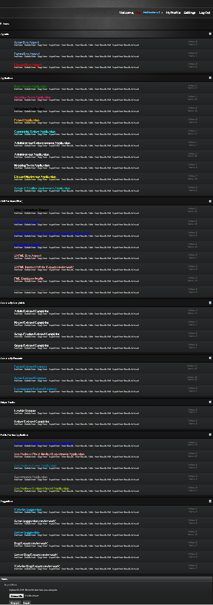
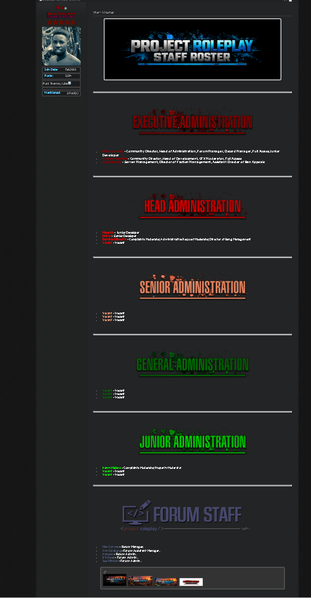
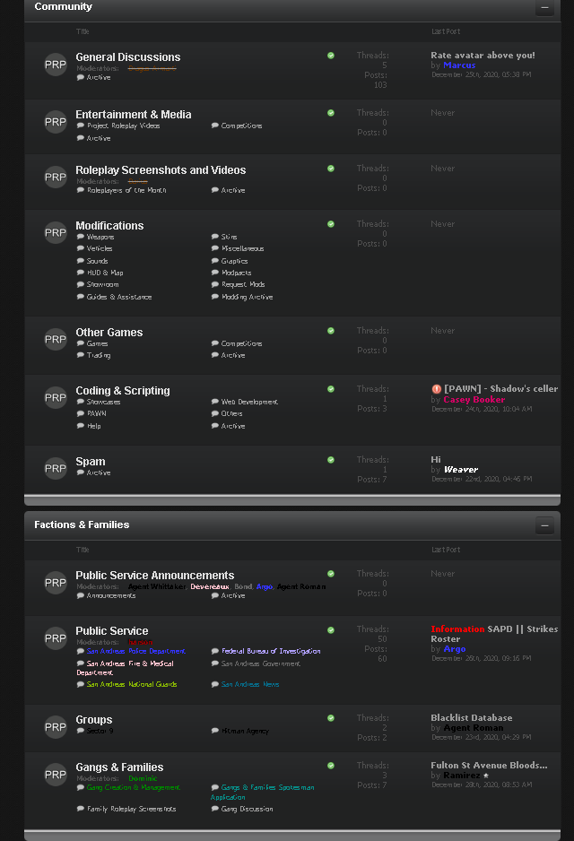
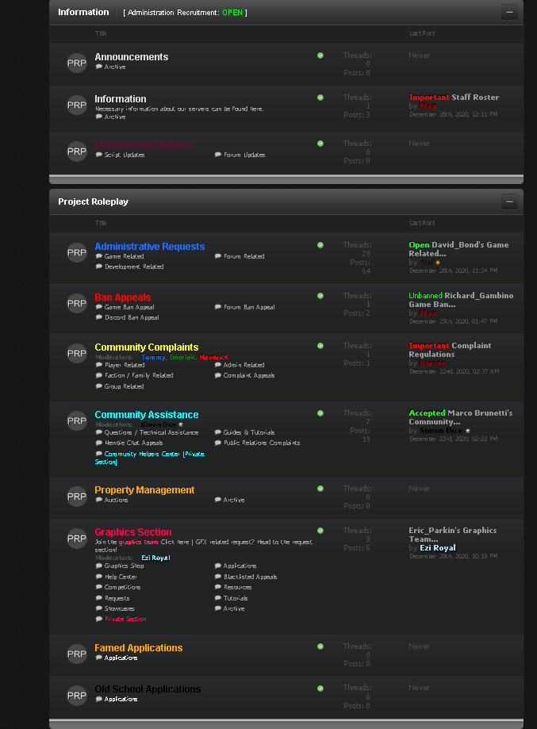

# Project Roleplay forum

Alongside the SA-MP server, Project Roleplay had a vBulletin 4 forum where players could find announcements, discuss factions, contact staff, and submit applications or appeals.

I installed, configured, and managed this forum independently. That included organizing the sections, maintaining the staff presentation, and handling the forum side of community administration. I used the existing vBulletin platform; I didn't write vBulletin itself.

I later restored the old forum locally from its files and database backup so I could document this part of the project.

## Screenshots

### Application and appeal forms
Templates and instructions members used when submitting applications or appeals.

### Staff roster
The forum's staff presentation and hierarchy.

### Community and factions
Sections connected to the roleplay community and its factions.

### Information and support
Information and help areas for community members.

## About the archive

The screenshots show the historical forum, not a currently hosted public service. The original vBulletin installation and member database are not included here. The restored installation uses outdated software and should remain isolated locally rather than being exposed to the internet.

[Back to the server project](../../README.md)
